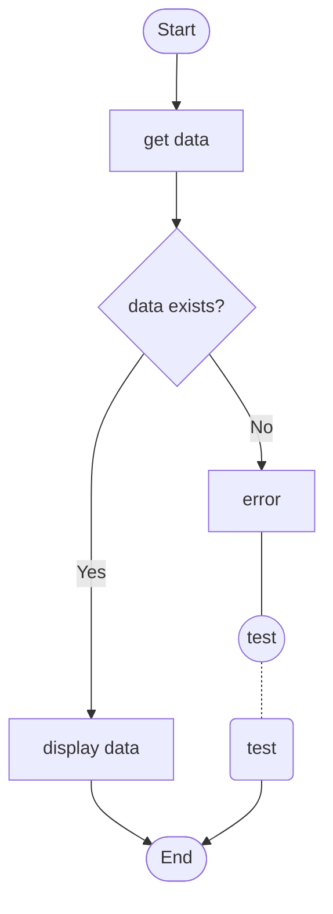
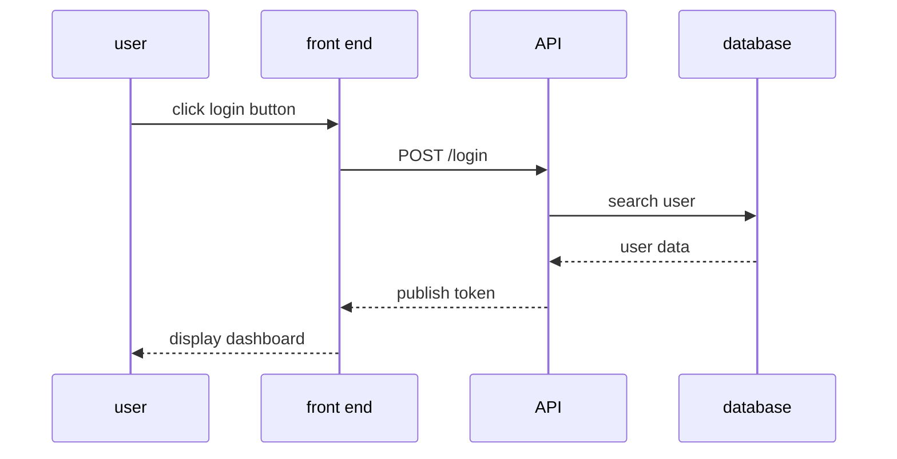

## index

- [How to install](#how-to-install)
- [How to use](#how-to-use)
- [Third party](#third-party)

## How to install

npm is necessary

## How to use

open the textbox

## Third party

third party

## How to set up

> [!IMPORTANT]
> node.js 24 is required.

> [!TIP]
> nvm is useful to switch node.js versions.

> [!CAUTION]
> Follow the rule.

> [!WARNING]
> `sudo npm install` is not good to use.

> [!NOTE]
> Windows is recommended.

